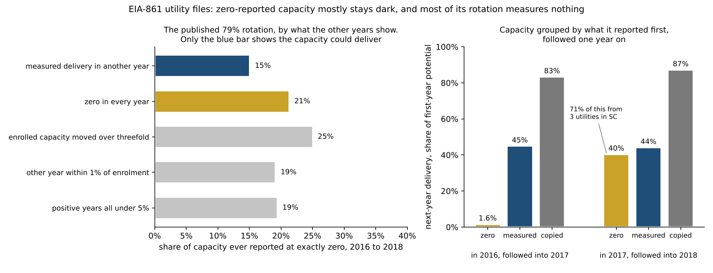

# Findings

**In one paragraph.** US utilities realise about 39% of the demand response peak
reduction they report as available, a gap of roughly 19 GW that has been stable
for twelve years. That measurement is solid. No interpretation of it is. The
data cannot distinguish capacity that was never called from capacity that would
not have delivered, and separating them needs a longer panel than exists. Priced
against PJM's published cost of new entry, demand response wins six of the eight
defensible pairings of accounting bases, including both pairings that align
every basis. And reported capacity per enrolled customer varies more than
fivefold across census divisions after adjusting for class mix, which is enough
room for inconsistent reporting to hold the entire gap. What decides the
economics is not how much capacity is enrolled but when it is called, and the
price in those hours is the one quantity neither the retail nor the wholesale
accounting reports.

### Scope, once, for the whole argument

Everything below is about utility-administered retail demand response in the
United States as reported to EIA, plus the published PJM, FERC and market
monitor figures it is compared against. Utility-level results cover 2015 to
2018; national results cover 2013 to 2024; cost results cover 2015 to 2024. It
says nothing about wholesale-only registrations, about any individual program's
performance during a specific event, or about markets outside the United States.
Modeled analyses are excluded from this file by rule and live in
[MODELED.md](MODELED.md).

### What would falsify it

The central claim is that the unrealised gap cannot be read as waste. Three
results would overturn it, and each is a test someone could run:

1. **The zero mass never delivering.** If utility-level data over a window long
   enough to matter showed capacity reported at zero almost never delivering a
   measured amount in its other years, the uncalled reading would fail for that
   share. The criterion first written here was different, and wrong in a way
   worth recording: it counted any rotation as support and persistence as
   refutation. Over three years persistence refutes nothing, since a reserve
   called once a decade also stays at zero, and most of the rotation turned out
   to be reports that measure nothing. On 2016 to 2018 data, 15% of the capacity
   ever reported at exactly zero shows a measured delivery in another year.
   Changing a criterion after the data arrive is exactly when a reader should be
   suspicious, so both versions stay stated. `python -m phantomload zero-mass`
   runs the corrected test.
2. **Event-level performance failures.** If program evaluations with event
   counts showed called capacity routinely delivering well below enrolment, the
   gap would be non-performance rather than non-dispatch, whatever the
   aggregates say.
3. **Consistent reporting.** If the fivefold regional spread in reported
   intensity turned out to be genuine program differences throughout, rather
   than partly definitional, the reporting explanation in section 10 would
   close, and the remaining gap would have to be accounted for by the other two.

Only the first has been run against data this repository can reach, on three
years, and it came back weaker for the uncalled reading than it was first
reported. Each section's numbered claims depend only on the sections above it.

Each section below opens with the question it answers. One file, every result,
with the provenance attached. Numbers are produced by `run_all.py` and pinned by
`tools/check_claims.py`.

## 1. What share of enrolled capacity actually shows up, and can we tell why?

**Answer.** 39.2% shows up. The aggregates cannot say why, and the panel needed
to settle it is longer than the panel that exists. Utility-level data narrows it
through the shape of the distribution, by less than this repository first
reported: exact zeros read as non-dispatch, and for most of them the data cannot
say whether the capacity would have delivered.

This section's headline figure is a reproduction. ACEEE published the same
result from the same series in 2017, and also named the identification problem.
See [PRIOR_WORK.md](PRIOR_WORK.md).

MEASURED. EIA-861, national, four sectors, 2013 to 2024.

US utilities report "potential peak demand savings", the peak reduction their DR
programs are said to be able to deliver, and "actual peak demand savings", the
reduction realised that year. The ratio averages 39.2%, leaving 60.8% of
enrolled capability unrealised. It runs 33.0% in 2016 to 45.4% in 2022 with a
flat trend, r2 0.01 on year, so this is a structural feature of how DR is
reported rather than a bad year or a recent slide.

By sector the ranking is not the one the folklore predicts. Residential has the
highest utilization, industrial and commercial the lowest, even though the
industrial sector supplies the largest block of enrolled MW.

The reason this is not a finding about wasted money is that the published
aggregates carry no dispatch-event count. They **cannot separate capacity that
was never called from capacity that would not have delivered** if it had been.
A program held for a 1-in-10-year condition and a program whose enrolment is
fictional report the same low ratio in a mild year.

That gap is quantifiable. A resource for a 1-in-T year event is genuinely quiet
in a given year with probability (1 - 1/T), so W quiet years reject the reserve
hypothesis at alpha only when

    W >= ln(alpha) / ln(1 - 1/T)

At alpha = 0.05, ruling out a 1-in-10-year reserve takes 29 years of quiet.
Inverting it, a 12-year panel can only rule out reserve designs with return
periods shorter than 4.5 years. Every published DR panel is shorter than the
identification requirement for the resources it is being used to judge.

This is an identity, and it is not even a new one. It is the rule of three,
published by Hanley and Lippman-Hand in JAMA in 1983: zero events in n trials
puts the 95% upper bound on the rate at about 3/n. The exact form above returns
29 years where the textbook approximation of 3T returns 30. Applying it to
demand response reserve identification looks new; the statistic is forty-three
years old. It is worth stating anyway, because the phantom-capacity argument is
routinely made on one year of data.

That correction has a name this repository reached without knowing. Inflating
the required window for a persistent process is an effective-sample-size
adjustment in the sense of Kish's design effect, where any binomial interval,
including the zero-event bound the rule of three comes from, is corrected by
replacing n with n divided by the design effect. At the strongest persistence
tested the chain implies a design effect of 2.2. The AR(1) form of the same idea
gives an effective size of n(1-rho)/(1+rho). No published source states the
dependence-corrected rule of three for the zero-event case, but every component
is standard, and the power-system literature meets the same problem from the
other side: Wilson and Zachary estimate loss-of-load from seven winter seasons
with within-season autocorrelation and report a 95% interval of 1.92 to 9.37
hours per season around a mean of 5.08, block-bootstrapping whole seasons rather
than assuming independence.

That closed form is also optimistic. It treats years as independent draws, and
extreme system conditions are not independent: heat domes persist, droughts run
multi-year, ENSO phases last seasons. Modelling occurrence as a two-state Markov
chain with the same long-run frequency, the required window grows monotonically
with persistence, reaching 65 years at persistence 0.6, which is 2.2x longer
than the independent answer. At zero persistence the chain is memoryless and the
formula collapses back to the closed form, which a test asserts, and a Monte
Carlo confirms the algebra to three decimals. So 29 years is a floor on what
identification needs, not the requirement.

### Where the slow decline comes from

National utilization is the enrolled-weighted mean of sector utilizations, so a
drifting aggregate can be sectors getting worse or the mix moving between them.
A shift-share split of the -4.7 points between 2013 and 2024 puts 118% of it
inside sectors, with the mix pushing the other way by about half a point. Freeze
the sector mix at its 2013 shares and 2024 lands at 38.5% instead of 39.1%, so
composition is holding the ratio up very slightly rather than propping it up.

The within-sector move is concentrated in commercial, which fell from 2013's
49.7% to 33.4% while its share of enrolled MW rose. Residential improved
slightly. Industrial lost ground on both counts, and it is the largest single
mix contributor because its share of enrolled capacity fell from 55% to 46%.

### The shape of the distribution, which discriminates where the level cannot

The two explanations predict different distributions, and that is testable even
though the level is not.

Capacity that would fail if called produces *partial* delivery: some customers
respond, some do not, and the reported number lands in the middle. Capacity that
was never dispatched produces *exactly zero*, because not calling an event is an
administrative fact with no partial version.

ACEEE's 2015 utility table, now vendored here, covers the 28 programs reporting
at least 200 MW of potential, 63% of national potential. Of the 25 reporting an
actual figure, five reported exactly zero, including Florida Power & Light at
1,666 MW of potential and nothing delivered, and Duke Energy Florida at 1,039
MW. Three more reported potential and no actual value at all. Together those
eight hold 14.3% of national enrolled capacity.

That zero mass is evidence that this part of the shortfall was not dispatched,
rather than dispatched and failed, and it is the first direct evidence in this
repository on the question rather than an argument about identifiability. It
answers half of it: not dispatched is not the same as available. Nadel proposed the mechanism in 2017: utilities long on
capacity are less likely to call demand response. Two large Florida load
management programs reporting zero in a mild year is what that looks like.

Above zero the distribution is continuous, 0.5% to 100% with no gap wider than
12 points and a median of 28%, and it separates nothing: partial calling and
partial performance are indistinguishable there. The verdict is a split one and
is reported as such.

### The full population, three years, and what persistence can and cannot decide

ACEEE's table is one year and the 28 largest programs. EIA's utility-level files
for 2016 to 2018 cover every reporting utility, and they reconcile to the
national panel to the megawatt in all three years. They also allow a test the
level never could: persistence.

A program that was not needed in a mild year reports zero that year and
something in a hard one. A program that does not work reports zero every year.
Among the 304 utilities reporting an actual figure in all three years, 278 never
reported zero and only 9 reported zero every year. Of the capacity ever reported
at exactly zero, 79% belonged to utilities that reported something positive in
another year. Earlier versions concluded from that that most of the zero mass
was available and not called. That conclusion is withdrawn, for the reasons
below, and the number stays because it is what was published.

**The number is not fragile.** It rests on six choices: what counts as zero,
whether a report equal to enrolled capacity counts as a delivery, which
utilities form the panel, how they are weighted, the unit of analysis, and
whether a program whose enrolled figure moved more than threefold is still the
same program. Varying all six gives 288 specifications. Weighted by capacity,
the rotating share runs from 44% to 85% and is a majority in 202 of 216
capacity-weighted specifications; counting utilities instead, it is a majority
in 37 of 72. The fourteen capacity-weighted failures all combine the same two
corrections, a 1% zero rule and treating near-copies as unreported. The
published panel sees 47% of the capacity reported at zero across the three
years, because it requires a report in every year.

**Its meaning is.** The statistic counts a utility as rotating if it reported
anything above zero in another year, and with 26 utilities behind it, three of
which hold 56% of the capacity, what each one reported matters more than any
specification. Classified by what their other years actually say:

| Capacity ever reported at exactly zero | Share | What it shows |
| --- | --- | --- |
| A measured delivery of at least 5% of potential in another year | 15% | the capacity can deliver; its zero years read as not called |
| Zero in every year | 21% | ambiguous over three years |
| Enrolled capacity moved more than threefold | 25% | the capacity at zero is not the capacity that later delivered |
| Another year within 1% of enrolled capacity | 19% | a full curtailment or a copied figure; the data cannot tell |
| Positive years all below 5% of potential | 19% | the program operates, at a small fraction of its enrolment |

The resized case is Salt River Project, which reported 1,844 MW of potential and
nothing delivered in 2016, about one megawatt per enrolled customer, then 86 MW
and 99 MW of potential in the next two years. The near-copy is Santee Cooper,
which after two years at zero reported 520.4 MW delivered against 520.5 MW
enrolled in 2018: either all 20 of its interruptible customers curtailed or a
copied field. Counting it as a real delivery raises the measured share to 34%.
The near-zero group is Ohio Edison, Toledo Edison and Appalachian Power in West
Virginia, all PJM members, whose positive years run from 0.5% to 3.5% of
potential.

Loosening the zero rule to anything at or below 5% of potential changes the
picture and shows how lumpy it is: 54% of that broader zero mass belongs to
utilities with a measured delivery elsewhere, and Alabama Power alone is 28% of
it.

**Followed forward, zero capacity mostly stays dark.** The rotation statistic
classifies utilities over three years. The more direct question is what happens
to the megawatts: of the capacity at exactly zero in one year that reported a
figure the next, how much delivered? Between 69% and 77% of it did report
again. Pooled over both transitions, it delivered 15% of its potential, against
45% for
capacity that delivered a measured amount the year before, and more than 80%
for capacity whose report simply copied enrolment. The two transitions differ
sharply. Capacity at zero in 2016 delivered 1.6% of its potential in 2017.
Capacity at zero in 2017 delivered 40% in 2018, but 71% of that came from three
South Carolina utilities, led by Santee Cooper's near-full report, and without
that one report it is 24%.

**What survives.** Exact zeros are non-dispatch rather than failed dispatch. For
about a sixth of them, a third if Santee Cooper's report is real, the data
shows the capacity can deliver. For the rest it shows nothing either way, which
is what three years can be expected to show about a resource that may be called
once a decade. One lead is worth following: whether the South Carolina
deliveries fell in the January 2018 cold snap, when neighbouring Duke Energy
Carolinas set a [peak demand record](https://www.greenvillebusinessmag.com/2018/01/09/164451/duke-energy-carolinas-peak-record)
on January 5. If they did, that is the uncalled-then-called pattern seen
directly, in the one place the data shows it.

Two categories are kept apart throughout because conflating them is the error
that would matter most. Exact zeros held 10.0% to 17.8% of enrolled capacity per
year. Utilities reporting potential but no actual figure at all held another
15.3% to 16.9%, and that second group says nothing about dispatch either way.

The largest persistent zero is Baltimore Gas and Electric, zero in ACEEE's 2015
table and in every year here. Its program bids into PJM's wholesale capacity
market, so a plausible reading is that the realised reduction is recorded in the
wholesale accounting rather than the retail one, which is the overlap track 7
says nobody publishes. That is offered as a hypothesis, not a finding.

The level is also worth noting against the aggregate. Weighted by capacity, the
28 largest programs realise 35%, slightly below the 40% national figure for the
same year, so the biggest programs are not carrying the average.

### How much of this is hidden by aggregation

FERC's annual assessment publishes the same EIA series cut by census division,
which raises the dispersion floor without reaching the truth. The regional cut
carries potential peak savings but not actual, so regional utilization is still
not observable. What can be computed is the spread that regional differences in
class mix alone would produce, holding each class at its national rate: 30.4% in
the East South Central to 37.9% in New England, a 7.6 point floor that ignores
every within-class regional difference.

Enrolled capacity is also concentrated. Three of nine census divisions hold
59.3% of enrolled capacity, led by the South Atlantic at 30%, so a national
average is carrying a small number of large regional programs.

One aggregation caveat that matters for anyone extending this. The
between-sector spread of utilization averages 11.0% across the panel and is the
only dispersion visible here. Total dispersion across programs is that plus a
within-sector term the national data cannot see, so treat 11.0% as a floor. The
2014 transportation row is the one place a material sector reported near-total
non-delivery, 1 MW realised against 353 enrolled, which is what the phantom
pattern would look like at scale if it were real.

## 2. Is demand response expensive once you price it per kW delivered?

**Answer.** It depends on a denominator on each side of the comparison, and the
two spreads are the same size, so neither can be waved through.

MEASURED on both sides now.

EIA-861 publishes demand response customer incentives and all other program
costs by sector for 2015 to 2024. Dividing by enrolled MW gives $50.39 per
kW-year in the latest year. Dividing by realised MW gives $128.78. The gap is
2.56x and is exactly 1/utilization, asserted as an identity in the tests.

PJM publishes the comparator, and it has the same structure. For the 2027/2028
Base Residual Auction the RTO gross cost of new entry is $149.31 per kW-year in
ICAP terms, the expected energy and ancillary services revenue offset is 54.2%
of that, and net CONE is $68.35. So the peaker spans 2.18x between its two
bases while demand response spans 2.56x between its two, 2.56x against 2.18x.
Neither denominator can be waved through.

What that does to the verdict:

- Demand response needs 33.7% to clear gross CONE. Measured utilization is
  39.2%, so it clears, and it clears in 10 of 10 years with costs published,
  by margins of $16 to $42 per kW-year.
- It needs 73.7% to clear net CONE. It clears in 0 of 15 PJM zones. In two of
  them, BGE and DOM, net CONE is below demand response's enrolled-basis cost
  outright, so no utilization would be enough.
- PPL's own PL zone sits between: net CONE $88.89 per kW-year, the only modelled
  zone where net CONE fell rather than rose between the two auctions.

### The netting asymmetry cannot rescue demand response

The obvious objection to the net CONE comparison is that it is unfair: demand
response costs are not netted of avoided energy purchases, while the peaker's
are published both ways. That objection is correct and it is not large enough.

The correction is bounded even though the number is not published, because the
energy column gives the hours. Avoided energy per delivered kW is just the
implied event hours, so the credit is hours times price. The gap between demand
response on the delivered basis and net CONE is $60.43 per kW-year. At the
pre-reclassification 93.5 event hours that needs avoided energy worth $0.65 per
kWh; at the post-reclassification 33.2 hours it needs $1.82. Sweeping event
hours across both eras and prices from 3 to 50 cents per kWh, 0% of that grid
clears, and the most generous corner still leaves demand response 1.20x over net
CONE.

Fifty cents per kWh is five hundred dollars per MWh sustained across every event
hour of a year. The correction is real, it is worth a few dollars per kW-year at
plausible prices, and it does not close a sixty dollar gap.

An independent check, and it disagrees in a useful direction. Brattle performed
exactly this netting for energy efficiency in 2021: gross CONE of $235 per
kW-ICAP-year less $177 of energy savings and $35 of transmission and
distribution savings, giving a net CONE of $23. Energy efficiency saves energy
in every one of 8,760 hours while demand response saves it in roughly 94, so if
both credits are right the ratio between them should track the ratio of hours.
It does not. The hours ratio is 94, the credit ratio is 37, and the leftover
factor is an independent estimate of what demand response's called hours are
worth: about 2.5 times an average hour, or roughly $127 per MWh. The synthesis
needs 8.5 times. Two routes, one conclusion, and the gap is short by a factor
of 5.1.

That is now anchored rather than asserted. PJM's independent market monitor
publishes the real-time load-weighted average LMP, $50.73 per MWh across 2025.
Closing the gap needs the called hours to price at 12.7x the annual
load-weighted average. Valued at the annual average itself, the correction is
worth $4.74 per kW-year and covers 7.9% of the gap.

The annual average is the wrong price and it is used only as a denominator. The
right one is the price in the hours a program is actually called, which is
higher by a factor nothing here measures, and the multiple above is the thing a
reader can judge rather than a dollars-per-kWh figure floating free. PJM's own 2024 decomposition attributed $0.10 per MWh of that year's $2.66
increase to the scarcity component. A year with almost no scarcity pricing
cannot deliver avoided energy at many times the average, so the requirement
above is a strong-targeting scenario rather than a base case, and it is stated
that way throughout. The hourly
series that would settle it is in PJM Data Miner, unreachable here.

The comparison still cannot be closed on that pairing, and the reason is
nameable rather than statistical: demand response costs are not netted of
avoided energy purchases, while the peaker's are published both ways. Gross-to-gross is the
basis-consistent pairing and it flatters demand response. Net CONE is what the
capacity market actually pays, and setting it against an un-netted demand
response cost is inconsistent in demand response's disfavour. Closing the gap
needs an avoided-energy estimate for demand response, which EIA does not
collect.

The sector ranking flips too: cheapest is industrial on the enrolled basis and
residential on the delivered basis.

Design call worth stating plainly: dividing by realised MW is only correct if
the shortfall is capacity that would fail when called. If it is capacity
correctly never called, the delivered basis punishes a capacity product for not
being an energy product. Track 1 shows the data cannot tell which, so both bases
are reported and neither is labelled the true one.

Unit note. Everything here is ICAP dollars per kW-year, because that is the unit
EIA's costs are in. Converting PJM to UCAP would require accrediting demand
response on PJM's basis as well, which is a different exercise from converting
one side. The vendored table carries PJM's UCAP column so the transcription can
be checked, and a test pins the trap that the implied ICAP-to-UCAP factor is not
the same in the two auction columns: 78.00% in 2026/2027 and 77.20% in
2027/2028.

## 3. Is residential demand response mostly price-based or mostly control-based?

**Answer.** Not mostly price-based. The exact mix is not identified, and the
modeling that tried to identify it lives in [MODELED.md](MODELED.md).

MEASURED, compared against cited evaluation ranges.

EIA reports 0.45 kW of realised peak reduction per enrolled residential
customer. Published evaluations of time-varying rates without enabling
technology, which report on the same per-customer basis, put the impact at
about 0.11 kW for critical peak pricing and 0.13 kW for a time-of-use pilot, and
the range used here runs to a deliberately generous 0.25. The measured figure is
1.8x to 9.0x anything a purely price-based fleet could produce, so the
residential demand response fleet is not predominantly price-based. The bound
is one-sided: nothing here excludes a fleet that is mostly direct load control.

A sanity check from the same literature points the same way. A mass-market
residential program reporting much above 1 kW per enrolled customer has almost
certainly mixed a per-device numerator into a per-customer denominator; this one
reports 0.45, which is weak evidence that EIA's denominator is genuinely per
customer.

Comparing against direct load control evaluations is harder, because those
report per AC unit or per thermostat while EIA counts customers, and no public
source supplies the bridge between them. The attempt, the contradiction it
produced and its resolution as a denominator mismatch are recorded in
[MODELED.md](MODELED.md), because every number in it depends on an assumed
response rate.

## 4. Could existing demand response absorb curtailed renewables?

**Answer.** Not as scheduled. The call window is aimed at the opposite corner of
the year and the day, and it hits that target hard.

MEASURED generation, PROXY curtailment. CarbonCast hourly generation by fuel,
CISO, ERCO and PJM, 17,544 hours each, 2020-2021.

Defining curtailment-risk hours as the top decile of instantaneous solar and
wind share, a summer-evening weekday call window contains far fewer of them than
chance would give: lift CISO 0.16, PJM 0.07, ERCO 0.00. In ERCO not one
curtailment-risk hour falls inside the window across the whole two years.

CISO oversupply concentrates at local hour 12 in May. The DR window is built for
the opposite corner of the year and the day. Moving to an all-year midday window
raises CISO lift to 2.46x, so the hours are reachable, but the product is not
the same: absorbing surplus requires increasing load, and an enrolled fleet of
curtailable industrial load and cycled air conditioners cannot do that.

The curtailment measure is a **proxy for oversupply conditions, not a
measurement of curtailed MWh**, so treat the lifts as timing evidence only.

The conclusion does not depend on how the proxy is drawn. Sweeping the threshold
across the top 5, 10, 20 and 25 percent of hours and swapping the definition
from renewable share to lowest net load gives 24 combinations, every one with
lift below 1 and below 0.5, max lift 0.45. The two definitions rank regions the
same way, correlating at 0.92.

One honesty note on that sweep. The net-load definition is close to
definitionally anti-correlated with a summer peak-shaving window, since the call
window is chosen to sit where net load is highest. It confirms the mechanism
rather than providing independent evidence, and the renewable-share results are
the ones carrying the finding.

### The mirror image: the window is aimed at scarcity, and it hits

The synthesis in section 9 ends on whether demand response is dispatched into
the hours that carry the value. The same series answers it, and the answer is
the opposite sign from the curtailment result.

Track 7's implied event hours put a real fleet at roughly 33 to 94 called hours
a year, which is the top 0.4% to 1.1% of hours. At that depth the summer weekday
evening window contains 59% to 76% of the highest-net-load hours, a lift of 11x
to 15x over chance. Set against the oversupply lift of at most 0.16, the same
window is 68-fold better at finding scarcity than surplus. That is not a
criticism of the window; it is what the window was built to do, and it means the
$0.43 per kWh the synthesis needs is being asked of hours that genuinely sit at
1.6x to 2.6x annual mean net load.

The blind spot is seasonal rather than hourly. 6 of ERCOT's top 200 net-load
hours fall on 14 and 15 February 2021, which a June-to-September window cannot
reach at all. That count is a floor and the caveat is larger than the number:
CarbonCast reports generation, not demand, so in a supply-side failure where
plants trip and load is shed, measured generation understates the demand that
existed. The one event in this window where demand response mattered most is the
event this dataset can least measure.

The storm is also not the whole story. Winter net load reaches 91% of its annual
maximum in ERCO and 85% in PJM, in ordinary months with no crisis attached, and
both sit outside a June-to-September window by construction. A call window built
around the summer peak is structurally excluded from most of the winter shoulder,
which is where a growing share of electrification-era stress is expected to land.
CISO, still summer-dominated at 60%, is the exception rather than the pattern.

**Scoping this before it gets overread.** Presented alone, that result implies
nobody has noticed, which is false. PJM retired three summer-only demand response
products and has required year-round availability from its sole forward capacity
product since the 2020/2021 delivery year, with performance assessed in winter as
well as summer. The wholesale market addressed this by rule about five years
before this repo measured it. The sourcing for those dates is the weakest in the
repository: trade press and one committee presentation, with the tariff not read
in this environment, and it is flagged as such in the code.

Two things survive the correction, and one is stronger for it. The scope: this
repo measures the EIA retail population, utility-administered programs rather
than wholesale registrations, and EIA publishes no seasonal availability at all,
so nothing here says whether a retail program can be called in January. And the
corroboration: PJM's own workaround, letting summer-only resources aggregate with
winter-only ones to form a qualifying bid, was reported as limited by how little
winter-capable resource was offered. That is the same asymmetry measured here
from hourly generation, showing up instead as a scarcity of bids, which is the
better confirmation because it is priced rather than modelled.

## 5. How many customers are exposed to tariff and program double counting?

**Answer.** Somewhere between one in nine and all of them, and the exposure is
concentrated in a few regions.

MEASURED. The attribution model that says how much of the claimed reduction is
really the tariff is in [MODELED.md](MODELED.md); this section is the part that
does not depend on it.

In 2023, 18,240,088 customers were enrolled in retail dynamic pricing programs,
meaning time-of-use, real-time, variable peak, critical peak pricing or critical
peak rebates, against 10.6 million in incentive-based demand response programs.
The intersection is not published, so it is bounded: between 10.9% and 100% of
demand response enrollees are also on a time-varying rate. The lower bound
assumes the two enrolments are independent, which is the wrong prior, since both
concentrate in the AMI-equipped customers of the same utilities.

The exposure is lopsided. Seven of nine census divisions have more customers on
dynamic pricing than in demand response programs, so the overlap could in
principle cover the whole demand response population there. Pacific at 5.76
dynamic-pricing customers per demand response customer is the extreme; the
South Atlantic, at 0.46, is the only large division where the arithmetic bounds
the overlap well below the full population.

## 6. Does poor utilization come bundled with heavy overhead?

**Answer.** No. The spec predicted compounding and the correlation has the
wrong sign.

MEASURED. The spec predicted that the program types with the worst utilization
also carry the heaviest overhead. The sign is wrong.

Pooled across sector-years, utilization and overhead share correlate at
r = +0.10. Residential carries 48.9% of its program cost as non-incentive
overhead, against 4.9% for industrial, an 8.9x spread in overhead per delivered
kW and 29x per customer. But residential also has the highest utilization. High
overhead buys something.

The pooled correlation is pseudo-replicated across four recurring sectors, so
the sector-mean version is reported next to it. Neither supports compounding.

The real structure is scale, not utilization: overhead per delivered kW is
overhead per customer divided by delivered kW per customer, and mass-market
programs lose on the denominator.

## 7. Does the dispatch utilization survive a second, independent estimate?

**Answer.** Yes, and it agrees on magnitude. It also inherits the identification
problem rather than solving it.

> **Retracted.** This track originally concluded that no genuine two-method
> cross-validation was possible with public data. That was a claim about the
> world made from having looked in one place. It is withdrawn. What follows is
> the corrected version.

Three candidates, in ascending order of usefulness.

**The energy column fails, as before.** Energy savings divided by realised peak
gives implied event hours, which is not a second view of the same quantity and
carries a break the peak column does not: at EIA's 2023 reclassification, energy
savings fall -69.9% while realised peak moves -5.4%. The implied hours are also
internally implausible as a dispatch record, 218 hours for residential and 25
for industrial in 2022. Residential demand response is not being called for 218
hours of discrete events; that column is capturing something else.

**Wholesale registrations are a real second measurement.** The seven RTOs and
ISOs report their own demand response participation, and FERC compiles it:
33,272 MW in 2024, which is 1.08x the national retail potential EIA reported for
2023, with MISO the largest single market. Different reporters, different
collection method, no shared instrument with EIA.

They measure partly disjoint populations, and this is the part that changes how
the rest of the repo should be read. EIA counts programs administered by
utilities. RTO reports count registrations in wholesale markets, including
third-party aggregations that never appear in a utility's EIA filing, and
excluding utility programs that never bid into a wholesale market. The overlap
is not published, so the two totals **must not be added**, and neither is a
national figure for demand response capacity on its own.

**Deployment during a real event is the closest thing to a direct check.** PJM
registered 8,526 MW for 2024 and deployed more than 4,000 MW during the June
2025 heat event, at the third-highest system peak in its history. That is a
dispatch utilization of at least 46.9%, a lower bound because the source says "more
than", against a national retail figure of 39.2%. Two accountings, two
reporters, one annual aggregate and one event, landing in the same range.

**And it changes nothing about identification.** PJM deployed what it chose to
call. The unrealised remainder is the same ambiguity track 1 describes: capacity
not needed, or capacity not there. A second measurement of the ratio inherits
the problem rather than solving it, which is why the corrected finding is more
useful than the retraction it replaces but still not a verdict.

### Two things in the regulatory record worth knowing

Registration-level double counting is documented, not hypothesised. FERC
accepted MISO's tariff revisions in July 2025 removing the ability to register a
resource as both an Emergency Demand Response resource and a Load Modifying
Resource, a structure that let participants draw capacity payments while
reducing the chance of being called as either. PJM already reports its own
totals as de-duplicated "unique MW" because Economic and Load Management
registrations can contain the same resource. Track 5 models this failure between
a tariff and a program; here it is one level up, between two wholesale programs.

Literal phantom capacity has been prosecuted. The Commission found fraudulent
activity and market manipulation against Ketchup Caddy, LLC, including
uncontracted resources offered into MISO's capacity market without the demand
resources' knowledge or consent, and a separate Voltus, Inc. investigation was
resolved by consent agreement. Together those actions carry $38.4M in civil
penalties and $7.6M in disgorgement. That establishes the mechanism exists. It
does not explain the aggregate: the amounts imply a footprint orders of
magnitude smaller than the roughly 19 GW gap between national potential and
actual peak savings, so enforcement is evidence of a real failure mode operating
at a scale that cannot carry the headline.

## 8. The headline is fragile, and the fragile part is the interesting part

See [FALSIFICATION.md](FALSIFICATION.md). Short version: the shortfall itself
survives every attack, including the best single year of the whole panel, which
still realises only 44.6% of mean enrolled capability. What does not survive is
the economic reading of it. **only a small share of the shortfall has to be
genuine reserve** for the answer to move, and against PJM's gross CONE the
required share is -8.8%, meaning demand response already breaks even with no
reserve credit at all. Against net CONE it is 56.8%. Track 1 says the data
cannot rule either out.

## 9. Capstone: under which accounting conventions is demand response cheap capacity?

**Answer.** Six of eight, including both conventions that mix nothing. Align
everything and the question becomes one about dispatch timing.

MEASURED on both sides, with one swept parameter.

Comparing demand response to a peaker needs three separate basis alignments, and
the public record aligns none of them.

- **Netting.** PJM prices its peaker gross and net of energy and ancillary
  revenue. EIA reports demand response cost gross only.
- **Accreditation.** PJM's CONE is quoted per nameplate MW, but the capacity
  market pays per accredited MW, and the reference resource accredits at 77.2%.
  That factor is not assumed here: it is recovered from PJM's own table by
  dividing net CONE in ICAP dollars per MW-year by net CONE in UCAP dollars per
  MW-day.
- **Dispatch utilization.** Demand response can be priced per enrolled or per delivered
  kW, and track 1 shows the data cannot say which is right.

Two bases each on three axes, with the demand response accreditation question
collapsed into its dispatch-utilization basis, gives eight pairings. Demand response wins
6 of 8. Both losses are the same pairing, delivered basis against net CONE, and
both carry at least one basis mismatch. Only two cells mix nothing, gross to
gross at nameplate and gross to gross at accredited, and demand response wins
2 of 2 internally consistent cells.

That is the finding. The framing under which demand response looks expensive is
the framing that haircuts one side and not the other.

### The headline survives its own analyst choices

"Six of eight" rests on three choices made once: the cost year, the auction
delivery year and the zone. Sweeping all three gives 300 configurations. Demand
response wins a majority of the eight pairings in 96.7% of them, and at the RTO
it wins exactly six of eight in every one of the ten cost years from 2015 to
2024. The range across every configuration is four to eight. The single tie at
four is the BGE zone, whose net CONE is unusually low because expected energy and
ancillary revenue covers most of its gross cost, which makes the net comparison
harder to win there than anywhere else in PJM. The delivery-year sweep has only
two auctions to vary over, which is thin but not vacuous.

### Correction: the dispatch utilization is not an accreditation factor

The grid above haircuts demand response by its dispatch utilization, which this
repository arrived at on its own and which the resource adequacy field does not
use. That field accredits supply-side resources by effective load carrying
capability or a performance derate, and demand-side resources from measured
reductions against a counterfactual baseline. Two methods, one comparison, which
is the asymmetry this section identified and which turns out to be a named and
litigated problem rather than a new one. See [PRIOR_WORK.md](PRIOR_WORK.md).

The distinction matters more than the terminology. ELCC asks what share of
enrolled capacity is dependable during critical hours. The dispatch utilization also
counts the years in which nothing was called, so it is harsher by construction,
and using it as an accreditation factor penalises demand response for not having
been needed.

Published ELCC values for curtailment demand response put a four-hour program at
about 83% in summer and 55% in winter, and a ten-hour program at about 100% and
82%. Accrediting on that basis moves demand response from $128.78 per delivered
kW-year to $60.71 per accredited kW-year, a factor of 2.12, and it wins 5 of 6
cells rather than losing the strict pairing.

Two splices are stated rather than hidden: those ELCC values are SPP-specific
and 2025-specific, and they are applied here to national cost data, so this is a
cross-footprint comparison. The direction of the correction does not depend on
the splice; the magnitude does.

The single cell demand response still loses is the winter four-hour case. That
is the seasonal finding from track 4 arriving by a third independent route,
after hourly generation data and after PJM's market rules and its shortage of
winter-capable bids. It arrives narrowly. At the published 55% demand response
costs 3.5% more than the accredited net CONE comparator, and an ELCC of 57%
would win the cell. Until v0.4.3 the cell was computed at 50%, which is E3's
four-hour figure at 6 GW of adoption rather than its winter figure, and the
margin looked wider than it is. So the third route agrees with the other two,
weakly, and the seasonal finding rests mainly on the first two.

Push it further and it terminates somewhere useful. The fully aligned cell nets
both sides and accredits both sides: demand response per delivered kW, less
avoided energy, against net CONE per accredited kW at $88.52. Clearing needs a
credit of $40.26 per kW-year, which at the higher event-hour figure means
avoided energy worth $0.43 per kWh averaged across every event hour of the year,
or 8.5x PJM's annual load-weighted average price.

That is not impossible, but it is only reachable if demand response is called
almost exclusively into scarcity-priced hours. Which converts the whole question
from "how much capacity is enrolled" into "when is it dispatched", and that is
the same conclusion track 4 reaches from hourly generation data by a completely
different route.

## 10. What would have to be settled before the ratio means anything?

**Answer.** Three things, and they are not independent.

Three separate questions sit between the measured 60.8% shortfall and any
interpretation of it, and this repo can close none of them with public data.

1. **Reserve or non-performance** (track 1, track 8 attack C). The aggregates
   record capacity that was not realised, not capacity that failed. A 12-year
   panel can only rule out reserve designs with return periods under 4.5 years,
   and under persistent extreme conditions even that is optimistic. Against
   gross CONE no reserve credit is needed at all, the required share being
   -8.8%; against net CONE 56.8% of the shortfall would have to be genuine
   reserve. The utility panel speaks to this only in part. Exact zeros read as
   non-dispatch rather than failed dispatch, and 15% of the capacity ever
   reported at exactly zero shows a measured delivery in another year. For the
   rest, three years cannot separate reserve from non-performance, which is the
   bound above at utility scale.

2. **Which accounting bases** (synthesis). Netting, accreditation and
   dispatch utilization each move the comparison, the public record aligns none of them,
   and demand response wins 6 of 8 pairings including both internally consistent
   ones.

3. **Whether respondents mean the same thing** (track 8 attack D). Mix-adjusted
   reporting intensity varies 5.5-fold across census divisions, enough room to
   hold the whole shortfall. Persistence across the two published years narrows
   it: most of the spread holds steady, which favours genuine differences in
   what is enrolled, but two divisions show one-year discontinuities that no
   real fleet produces. Both mechanisms are present and the data cannot weigh
   them.

They are not independent. Question 3 undercuts the denominator that questions 1
and 2 both operate on, so resolving the accounting bases while leaving the
reporting question open would produce a precise answer to the wrong ratio.

The one thing that would move all three at once is respondent-level data with
event counts. That is roadmap items 1 and 2, and it is the whole shopping list.

## 11. What produces each part of the gap?

**Answer.** The gap is three things that behave differently, and none is
explained. The zero mass is non-dispatch of mostly undetermined availability,
the unreported share is not accounted for, and the largest piece is open.

MEASURED, EIA-861 utility files 2016 to 2018, every reporting utility, with
balancing-authority codes carried back from 2017 and 2018 to 2016 by utility.

| Component of enrolled capacity | 2016 | 2017 | 2018 | What it behaves like |
| --- | --- | --- | --- | --- |
| Realised | 33.0% | 38.9% | 40.5% | |
| Partial delivery | 32.7% | 34.3% | 34.1% | sticky within a utility; any regional component is specification-dependent |
| No actual reported | 16.6% | 16.9% | 15.3% | more common outside organised markets only because of Florida |
| Exact zero | 17.8% | 10.0% | 10.2% | non-dispatch; a measured delivery elsewhere for 15% of it |

**The zero mass is non-dispatch, and mostly unexplained beyond that.** Track 1
shows exact zeros look like programs not called rather than called and failed,
and that the capacity has shown it can deliver for a minority of them. Earlier
versions also read the footprint split as ruling out the obvious alternative,
that zeros and blanks are reductions booked in a wholesale settlement rather
than the retail filing, which would make them cluster inside RTO footprints.
Pooled, they cluster outside: 39% of capacity outside RTO footprints is at zero
or unreported, against 22% inside, a ratio of 1.8.

That comparison was then varied 96 ways, over the footprint definition (all
seven RTOs and ISOs, or only the four with capacity markets), the status
counted, the weighting, each year alone and the treatment of resized programs,
and in every specification each state was dropped in turn. States are the right
unit to drop, because utilities in one state share a regulator, a climate and
usually a reporting habit. The outside share is higher in 69 of 96, and stays
higher whichever single state is dropped in 48 of 96. The state that matters is
Florida. Florida Power & Light, Duke Energy Florida, Tampa Electric and the City
of Tallahassee reported zero or nothing in every year, and Florida holds 25% of
the capacity outside RTO footprints and 53% of the zero-or-unreported capacity
there. Without it the combined shares are 25% outside against 22% inside, exact
zeros are still more common outside (15% against 8%), and unreported capacity
is more common inside (14% against 9%). Taken one year at a time, exact zeros
were at least as common inside footprints as outside in 2 of 3 years.

So wholesale bookkeeping is neither supported nor ruled out as a general
explanation. Nadel's mechanism, utilities long on capacity not calling, may
describe Florida, where the Public Service Commission's own
[description](https://floridapsc.com/pscfiles/website-files/PDF/Publications/Reports/ElectricGas/AnnualReport/2018.pdf)
of FPL's residential load management says it is used during periods of extreme
demand, capacity shortages or system emergencies, an emergency-only design that
would report zero in most years at the annual peak. It is not shown to describe
anything wider. All four of those Florida utilities also move between reporting
zero and reporting nothing from one year to the next, which says that for some
filers the distinction this repository keeps most carefully, between a zero and
a blank, is not a stable one.

**The unreported share is not accounted for.** It looked concentrated outside
RTO footprints, which was read as ruling out wholesale bookkeeping; without
Florida it is more common inside. What it is, non-response, exemption, a
reporting convention or bookkeeping in another accounting, is not answerable
from these files.

**Partial delivery is the largest piece and the open question.** Utilities that
delivered some but not all of their potential account for 49% to 57% of the gap
every year. If system conditions decided how much of each program got called,
utilization would move together across utilities in the same footprint in the
same year.

> **Rescoped.** An earlier version of this section concluded that partial
> delivery does not move with regional conditions, on the strength of a single
> specification: footprint-by-year shocks explained
> 6.0% of year-to-year variation against 5.6% under shuffled labels, p = 0.36,
> with a power check
> showing a shock of SD 0.05 would have been detected. That test rested on two
> choices made once, and when they were varied the conclusion did not hold.

The two choices are whether to include reports where actual exactly equals
potential, and how many utilities a footprint needs before it is tested. The
first matters because 63 utilities in this panel report utilization of exactly
1.0 in every year; an observation fixed by convention adds no variance and pulls
every regional average toward zero, which biases the test toward a null. The
second matters because footprints with few utilities add noise.

Across the grid of three inclusion rules and three footprint thresholds, the
regional common share exceeds its shuffled-label null in all nine
specifications and is significant in 3 of 9, with p from 0.0055 to 0.36. With
every report included, as first published, nothing is detectable. Excluding
utilities that ever report actual equal to potential, a modest regional
component appears, about 11% of year-to-year variation against 6% expected.

So this component is specification-dependent, and the honest summary is that it
leans slightly toward dispatch responding to system conditions, rather than
toward a fixed property of each program, without either being established. The
three candidate mechanisms remain: a definition, where potential is a fixed
multiple of what a program ever delivers; a protocol, where a program is always
called at a fixed share; and a consistent partial response, which is the phantom
reading this repository argues against. Event-level evaluations would separate
them, and of everything left open here this matters most, because it is half the
gap.

### A third of reported deliveries are not measurements

Among utilities reporting a positive actual figure, 30% of reports set actual
exactly equal to potential, and they hold 13% of positive capacity. The habit is
concentrated in small programs, 55% of the smallest quarter against 16% of the
largest, and it persists: of 278 utilities reporting a positive figure in every
year, 67 report exact equality in every year and 174 never do. A program whose
delivered figure equals its enrolled figure three years running is recording a
contract or copying a field, not measuring how much load actually came off.

This is the most direct evidence on the reporting question in attack D, which
until now rested on a regional spread in reported intensity that genuine program
differences could also produce. Exact equality, repeated, has no such ambiguity.

> **Withdrawn.** v0.4.0 reported that utilization falls steeply with program
> size and led with the claim that the national number is a statement about
> large programs, with the median utility realising 67% of potential. Most of
> that gradient was the convention above. The raw medians still run from 96% in
> the smallest quarter of programs to 48% in the largest, and the largest quarter
> still holds 87% of enrolled capacity, but on reports that carry a measurement
> the rank correlation weakens from -0.30 to -0.13 and the median utility
> realises 50%, close to the capacity-weighted figure.

The class split settles it. If large programs realised less because they are
disproportionately industrial interruptible contracts, the gradient would vanish
within class. On raw reports it does not: it is significant within residential,
commercial and industrial alike. On measured reports it vanishes in every class,
with no within-class correlation larger than 0.11 in magnitude and none
significant. So the gradient was neither class mix nor program size. It was the
convention.

What remains is a weak pooled gradient, rho -0.13 on measured reports with
p = 0.03, probably a small class-mix effect, and a practical lesson for anyone
reading one program's number: check whether its delivered figure is its enrolled
figure before comparing it with anything.

## Cross-track thread

The same shape shows up in six of the eight tracks: the number is not in dispute,
the denominator is. Utilization depends on whether uncalled capacity counts
against you. Cost depends on enrolled versus delivered, and now also on gross
versus net CONE on the other side of the comparison. Attribution depends on the
baseline. Curtailment absorption depends on which hours you call the window.
Overhead depends on per customer versus per delivered kW. In every case the
measured quantity is solid and the contested step is the accounting convention
wrapped around it, which is also why the phantom-capacity claim is so easy to
make and so hard to support.

The strongest version of the finding is therefore not that demand response is
wasteful. It is that the public record supports eight defensible answers to "is
demand response cheap capacity", separated by accounting choices rather than by
evidence, that every published version of the claim picks one without saying so,
and that the two choices which mix nothing both favour demand response.

What survives all of it is narrower and more useful than the tagline. The
shortfall is real and stable. It cannot be read as waste, on three independent
grounds. And the quantity that actually decides the economics is when demand
response is dispatched, which neither the retail nor the wholesale accounting
reports.

That is a smaller claim than the repository name promises, and it is the one the
evidence supports. See the note on the name in the README.
