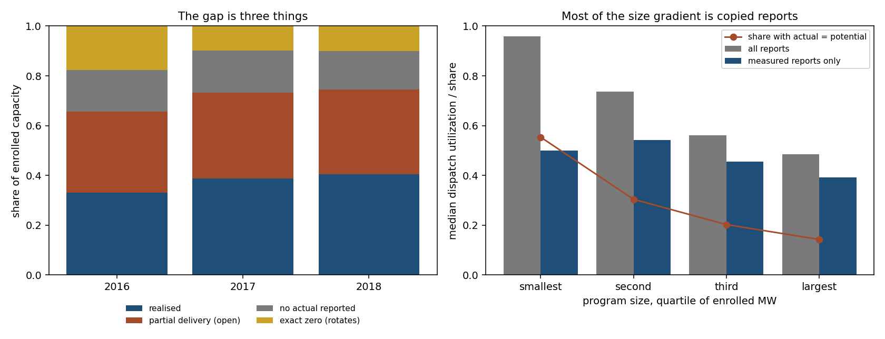
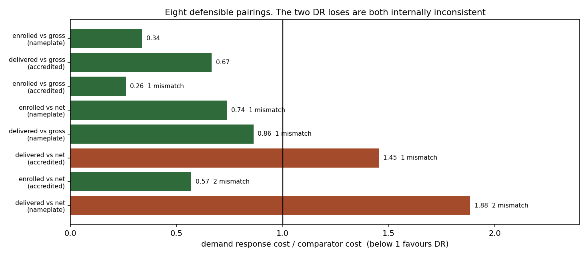
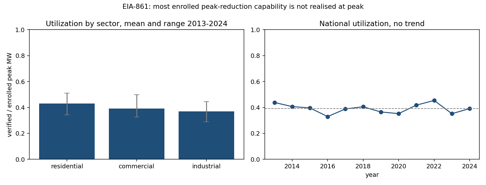

# PhantomLoad: the 61% of US demand response capacity that goes unrealised is not evidence of waste

Does the demand response capacity utilities enrol but never deliver represent
wasted money?

## The question

Every year US utilities report two numbers to the federal government: the peak
reduction their demand response programs *could* deliver, and the reduction they
*actually* delivered. The second is consistently about 39% of the first. The gap
is roughly 19 GW, it has held for twelve years, and it is the empirical basis for
a familiar argument: that a large share of enrolled demand response is capacity
nobody can call on, paid for by ratepayers and counted in reliability filings.

This repository tests that argument against the public record.

## The answer

The gap is real. The argument is not supported, and the reason is more
interesting than either.

Three separate questions stand between the measurement and any interpretation of
it, and the public data settles none of them.

**Is the unrealised capacity absent, or merely uncalled?** The aggregates record
capacity that was not realised, not capacity that failed, and separating them
takes a longer panel than exists: rejecting a one-in-ten-year reserve at 95%
confidence requires 29 years of quiet, and more under realistic weather
persistence, against twelve years of data. That bound is the **rule of three**,
a standard result from 1983, applied here rather than derived here.

Utility-level data settles part of it anyway, through the shape of the
distribution rather than its level, and it settles more of it than any other
evidence here. Capacity that would fail if called produces *partial* delivery.
Capacity never dispatched produces *exactly zero*, because not calling an event
has no partial version. And a program that was merely not needed in a mild year
reports zero in that year and something in the next, while a program that does
not work reports zero every year.

EIA's utility-level files for 2016 to 2018 test both predictions across every
reporting utility. Each year, utilities reporting exactly zero held
**10.0% to 17.8% of enrolled** capacity, and those reporting no actual figure at
all held another **15.3% to 16.9%**. Among the 304 utilities reporting a figure
in all three years, only **9 of 304** reported zero every year, and **79% of the
capacity** ever reported at zero rotated: zero one year, positive another. That
is the signature of capacity that was available and not called, not capacity
that was absent. The largest persistent zero is Baltimore Gas and Electric,
which reported zero from 2015 through 2018, and whose program bids into PJM's
wholesale market, so its peak reduction may simply be recorded in the other
accounting. Above zero the distribution is continuous and separates nothing.

**Nearly a third of reported deliveries are not measurements.** Among utilities
reporting a positive actual figure, **30% of reports set actual exactly equal to
potential**, rising to 55% of the smallest programs, and 67 utilities do it in
every year. A program whose delivered figure equals its enrolled figure three
years running is recording a contract or copying a field. That convention
explains most of a result this repository published and has now withdrawn: an
apparently steep fall in utilization with program size, from 96% of potential in
the smallest quarter of programs to 48% in the largest. On reports that carry a
measurement the gradient is weak (rho -0.13), and the median utility realises
**50% excluding those reports**, close to the capacity-weighted national figure,
not the 67% the raw reports suggest. Size still matters for reading a single
program's number, mainly because small programs so often report a contract
rather than an outcome. `python -m phantomload benchmark` compares against peers
of similar size and flags the convention.

**The gap is three different things, and they behave differently.** In 2018 the
unrealised 59.5% splits into partial delivery (34%), capacity with no actual
figure reported (15%), and the zero mass (10%). Partial delivery is the largest
piece every year, **49% to 57% of the gap**, and whether it responds to system
conditions is the question this repository could not settle. If system need
decided how much of each program got called, utilization would rise and fall
together across utilities in the same footprint. Whether that shows up depends
on two choices made once: whether to include the reports where actual simply
equals potential, and how many utilities a footprint needs before it counts.
Across the nine combinations, the regional common share exceeds what shuffled
labels produce in all nine and is significant in **3 of 9**, with p ranging
from 0.0055 to 0.36. With every report included, as first published, nothing is
detectable (**p = 0.36**); excluding the copied reports, a modest regional
component appears. So this part of the gap is open, leaning slightly toward
dispatch rather than structure, and it is the most important open question in
the repository.

The zero and unreported shares are not wholesale bookkeeping either. If they
were reductions recorded in an RTO's settlement instead of the retail filing,
they would cluster inside RTO footprints. They cluster outside: **39% outside
RTO footprints against 22% inside**. That fits the mechanism ACEEE proposed in
2017, utilities outside organised markets that are long on capacity simply not
calling, though testing it needs reserve margins this repository does not have.



An earlier version of this paragraph rested on ACEEE's 2015 table of the 28
largest programs, where 5 of 25 reported exactly zero, including
**Florida Power & Light Co reported 1,666 MW** of potential and none delivered,
with a **median 28%** across the rest. The full population supersedes it and
agrees with it.

**Is it expensive?** Pricing demand response against a peaker requires aligning
three accounting bases, and the public record aligns none of them. Enumerate
every defensible pairing and demand response wins six of eight, including both
pairings that mix nothing. The framing under which it looks expensive is the
framing that haircuts one side and not the other.

That understates the case, and the correction came from reading the resource
adequacy literature. This repository had been haircutting demand response by its
dispatch utilization and treating that as an accreditation factor. It is not one.
The field accredits demand response by effective load carrying capability, which
asks what share of enrolled capacity is dependable in critical hours, while the
dispatch utilization also counts years when nothing was called. Published ELCC
values put a four-hour curtailment program at **about 83% in summer**, against
the 39% this repo had been using, which moves demand response from $128.78 to
**$60.71 per accredited kW**-year, **a factor of 2.12**. On that basis it wins
**5 of 6 cells**. The one it loses is the winter four-hour case, which is the
seasonal problem below arriving by a third route.

**Do respondents even mean the same thing?** After holding class mix constant,
reported capacity per enrolled customer varies more than fivefold across census
divisions. Imposing the least intense division's reporting standard on everyone
erases the gap entirely. That is not evidence that the gap *is* a reporting
artefact, since genuinely different programs produce the same signature. What it
means is that nobody can call the gap non-performance without first arguing that
reporting is consistent across respondents, and no such argument appears in the
source.

What survives is narrower and more useful than the headline. The measurement is
solid. Every reading of it turns on an accounting choice rather than on
evidence. And the quantity that actually decides the economics is *when* demand
response is called, not how much is enrolled: the call window hits the scarcity
tail at 11x to 15x over chance, while the price in those hours is the one number
neither the retail nor the wholesale accounting reports.



## The evidence in one screen

| | |
| --- | --- |
| Dispatch utilization | 39.2% mean, 2013 to 2024, no trend worth reporting |
| Exact-zero reporting, every utility, 2016 to 2018 | 10.0% to 17.8% of enrolled capacity per year |
| Share of zero-reported capacity that rotates between years | 79%, favouring uncalled over absent |
| Cost, enrolled basis | $50.39 per kW-year |
| Cost, delivered basis | $128.78 per kW-year |
| PJM comparator | $149.31 gross CONE, $68.35 net, both per kW-year |
| Accounting pairings favouring demand response | 6 of 8, and 2 of 2 internally consistent |
| That verdict across every cost year, auction and PJM zone | majority in 96.7% of 300 configurations |
| Accredited the way the field accredits, not by dispatch utilization | 5 of 6, losing only the winter four-hour case |
| Reserve share needed to flip the cost verdict | -8.8% against gross CONE, 56.8% against net |
| Regional spread in reported intensity | 5.5-fold, mix-adjusted |
| Scarcity targeting of the call window | 11x to 15x over chance |
| Oversupply targeting of the same window | 0.07x to 0.16x |

Full write-ups in [FINDINGS.md](FINDINGS.md), the attacks on all of it in
[FALSIFICATION.md](FALSIFICATION.md), and the rules the work runs on in
[METHOD.md](METHOD.md), most of which are portable to research that has nothing
to do with demand response.

> **Retracted from the first version.** This repo originally swept an assumed comparator range of 80 to 150 dollars per kW-year with a central value of 115, described as the commonly quoted CT range. Pulling PJM's actual planning parameters showed the range was wrong in the way that mattered: net CONE for the RTO is $68.35, below the assumed floor, and it is the number that decides the comparison. The assumed range would have made the cost verdict look like a close call driven by uncertainty. It is not. It is driven by which CONE basis you pick, and that is a choice, not an error bar.

## Who this is for, and what to do with it

**Commission staff and regulators** reviewing demand response filings, integrated
resource plans or capacity claims. Start with [CHECKLIST.md](CHECKLIST.md): eight
questions to ask before reading a potential-versus-actual gap as underperformance,
each with the evidence behind it and the data request that answers it.

**Utility planners and program managers.** Place your program among every US
program of similar size, since size matters more than anything else visible here:

    python -m phantomload benchmark --potential 120 --actual 45

With several years of your own records, run the test this repository's main
result rests on: `python -m phantomload zero-mass your_data.csv`.

**Resource adequacy and capacity market analysts.** FINDINGS section 9 and the
accreditation correction: the eight pairings of accounting bases, why a
realisation ratio is not an accreditation factor, and why the winter four-hour
case is the one demand response loses.

**Researchers.** [ROADMAP.md](ROADMAP.md) is a research agenda organised by how
much of the gap each open question carries, with the competing explanations,
the test that would separate them, where the data lives and the function to
start in. The most valuable single question, whether partial delivery responds to
system conditions, accounts for half the gap.

**Journalists and advocates.** The short version: the national shortfall is real,
a large part of what utilities report as delivered is a contract figure rather
than a measurement, and the public data cannot show the shortfall is waste. [CHECKLIST.md](CHECKLIST.md) says what would have to be shown first.

## A note on terminology

The ratio this repository is about, EIA's *actual* peak demand savings divided by
its *potential* peak demand savings, is called **dispatch utilization** here.
That name is coined for this work because the obvious one is taken.

In evaluation practice, **realization rate** means evaluated savings divided by
*claimed* savings for a program that was in fact dispatched, and it measures
measurement error. Dispatch utilization measures something else entirely: how
much of an available capability was called on. A program can have a realization
rate of 1.0 and a dispatch utilization of 0.0 in the same year, by performing
perfectly on every event while being called for none. Most of the gap this
repository studies is the second thing, not the first, and early drafts used the
borrowed term and were wrong to.

## Scope, and what was not checked

Everything here measures **utility-administered retail demand response**, the
population EIA-861 collects. Wholesale market registrations reported by the RTOs
and ISOs are a separate and comparably sized accounting, 33,272 MW in 2024
against 30,542 MW of retail potential in 2023. They overlap, the overlap is not
published, and the two totals **must not be added**. Track 7 works through what
the second accounting does and does not settle.

**Part of this was published in 2017 and the repository did not know.** ACEEE
analysed the same EIA series at utility level nine years earlier, reported the
same dispatch utilization, and stated the uncalled-versus-absent problem in one
sentence. The headline here is a reproduction, **not a discovery**. See
[PRIOR_WORK.md](PRIOR_WORK.md), which also records what that work supplied:
the utility-level table now driving the dispersion result above, which this
repository had been listing as unavailable.

**No systematic literature review has been performed.** The environment this was
built in reaches government data portals, market monitor reports and open web
pages, not journals. Four literatures are likely to hold more of this already
and PRIOR_WORK.md names them. Nothing here should be presented as novel until
that search happens. It should be presented as computed, checked and
reproducible, which it is.



## About the name

Two problems with it, and the second is worse than the first.

**It claims more than the findings support.** "PhantomLoad" implies the shortfall
is capacity that does not exist. Three of this repo's own results argue against
reading it that way: the data cannot separate uncalled capacity from
non-performing capacity (track 1), the internally consistent cost comparisons
favour demand response (synthesis), and reported enrolment intensity varies
enough across regions to hold the entire shortfall on its own (track 8, attack
D). Prosecuted cases of literally fabricated capacity exist, at a scale orders of
magnitude too small to carry the aggregate.

**It already means something else in this field.** "Phantom load" is established
usage for standby draw, the few watts a television or charger pulls while
switched off. Someone searching the term wants that, not this. There is also an
exact-name repository on GitHub, `priyajs/phantomload`, about load testing.
Neither is a licensing problem; both are a findability problem, which is the one
that matters for a research repo.

**What it should probably be called, and a correction.** An earlier version of
this section recommended `dr-realization`, on the grounds that realization rate
was the industry term for this ratio. It is not: realization rate means
evaluated over claimed savings for a dispatched program, a different quantity
measuring a different failure, and a name built on it would have mis-described
the work to exactly the evaluators most likely to search for it. See the
terminology note above.

The standard this repository is published against asks for a name that works as
a proper noun for the work rather than the generic term for the phenomenon, so
that citations do not leak to the concept. Two candidates fit what the findings
now say, which is that most unrealised capacity was available and not called:
`benchstrength`, for capacity sitting on the bench, and `dispatchgap`, for the
gap between what is enrolled and what is dispatched. Both were checked and are
free on PyPI and unused under the author's GitHub account; `uncalled` is taken.
`tools/rename.sh` performs the rename end to end, including the package
directory, imports, packaging metadata, citation file and every doc reference,
and re-runs the tests and the claims guard afterwards.

The name has been left alone here on purpose. Renaming after the fact would tidy
away how much the conclusion moved, and the tagline is worth reading as the claim
being tested rather than the claim being made. But if this is ever published,
rename it first.

## What is measured, what is calibrated, what is simulated

This matters more here than in most repos, because the tempting version of this analysis is entirely synthetic. Every result row carries a `provenance` column, and the tracks are honest about which bucket they are in.

| Bucket | Tracks | What it rests on |
| --- | --- | --- |
| Measured | 1, 2, 6, 7 | EIA-861 national DR aggregates by sector, 2013-2024, transcribed from published Electric Power Annual tables. Nothing modelled. |
| Measured input, proxy outcome | 4 | Real hourly generation by fuel for CISO, ERCO and PJM from CarbonCast. Curtailment itself is a **proxy for oversupply conditions, not a measurement of curtailed MWh**. |
| Measured, second source | 2's comparator, 1's regional cut, 5's denominator, 7's wholesale check | PJM RPM planning parameters for the 2026/2027 and 2027/2028 auctions, and FERC's 2025 Assessment of Demand Response and Advanced Metering, which carries EIA-861 by census division plus wholesale registrations reported by the RTOs themselves. |
| Assumption, swept | 3, 5, storage comparator | Price elasticities, DLC response rates, storage capacity cost. Every one is a range in `phantomload/shared/calibration.py`, swept end to end, never a point estimate. |
| Identity | the cost algebra in 2, the window math in 1 | True by construction. Reported as identities so they are not mistaken for findings. |

There is no track here whose headline depends on a number this repo invented.

## Findings

| Track | Question | Result |
| --- | --- | --- |
| 1 utilization | What share of enrolled capacity shows up? | 39.2% mean, stable for 12 years. More usefully: a 12-year panel can only rule out reserve resources designed for events more frequent than **4.5 years**. Ruling out a 1-in-10-year reserve at 95% needs **29 years of quiet**, and that closed form assumes independent years: model extreme conditions as persistent and it takes **65 years at persistence 0.6**, **2.2x longer**. Phantom and reserve are not separable here. A shift-share split of the **-4.7 points** since 2013 puts **118% of it** inside sectors rather than in the mix, driven by **commercial, which fell from 2013's 49.7% to 33.4%**. Regionally, class mix alone implies utilization ranging **30.4% in the East South Central to 37.9% in New England**, and three census divisions hold **59.3% of enrolled capacity**. |
| 2 cost | Still cheap per kW delivered? | $50.39 enrolled, $128.78 delivered, against PJM's published $149.31 gross and $68.35 net CONE. Demand response needs **33.7% to clear gross CONE** and **73.7% to clear net CONE**; measured utilization is 39.2%, so it clears one and misses the other by half. In PPL's own PL zone net CONE is **$88.89**, the only zone where net CONE fell year over year. Energy revenue is **54.2%** of the RTO peaker's gross cost, which is the size of the netting asymmetry, but correcting it cannot rescue demand response: the gap to net CONE is **$60.43 per kW-year** and closing it would need avoided energy worth **$0.65 per kWh** across every event hour, which is **12.7x the annual load-weighted average** PJM LMP, so **0% of that grid** of plausible hours and prices clears. Priced at the annual average itself the correction covers **7.9% of the gap**. The cheapest sector also flips: **industrial on the enrolled basis and residential on the delivered basis**, and **commercial demand response costs more per delivered kW than building the peaker** on either basis. |
| 3 price vs DLC | Is residential DR mostly price-based? | No. Measured delivery of **0.45 kW** per enrolled customer is **1.8x to 9.0x** what any purely price-based fleet produces, against evaluation values reported on the same per-customer basis. The program mix itself is not identified; the modeling that tried, and the units contradiction it surfaced and resolved, is in [MODELED.md](MODELED.md). |
| 4 curtailment | Can DR absorb curtailed renewables? | Not as currently scheduled. Lift of curtailment-risk hours inside a summer-evening call window is **CISO 0.16, PJM 0.07, ERCO 0.00**, all far below 1. CISO oversupply peaks at local **hour 12** in May, not at the evening peak. Move the window to all-year midday and the lift becomes **2.46x**, but that is a different product: absorbing surplus needs load increase, not load shed. Robust across **24 combinations** of threshold and proxy definition, **max lift 0.45**. The mirror image holds too: the same window captures the scarcity tail with lift **11x to 15x**, containing **59% to 76%** of the top 94 net-load hours, a **68-fold** targeting asymmetry. It was built for the second job. Its blind spot is seasonal, not hourly: **6 of ERCOT's top 200** net-load hours are February 2021, unreachable by a summer-only window, and that count is a floor because generation data cannot see shed load. The gap is structural rather than storm-specific: winter net load reaches **91% of its annual maximum in ERCO**, 85% in PJM. Scoped, though: PJM's wholesale market retired **3 summer-only products** and has required year-round availability **since the 2020/2021 delivery year**, so this applies to the retail population EIA measures, which publishes no seasonal availability at all. |
| 5 double counting | How many customers are exposed to tariff and program double counting? | **18,240,088** customers were on a time-varying rate in 2023 against 10.6 million in DR programs, so the overlap is between **10.9% and 100%** of DR enrollees, led by **Pacific at 5.76** dynamic-pricing customers per DR customer. How much of the claimed reduction that overlap inflates depends on an attribution model, which is in [MODELED.md](MODELED.md). |
| 6 overhead | Does bad utilization come with heavy overhead? | No. The compounding hypothesis fails: pooled correlation across sector-years is **r = +0.10**, the wrong sign. Residential carries **48.9%** of program cost as non-incentive overhead against industrial's **4.9%**, an **8.9x** spread per delivered kW, but residential also has the best utilization. |
| 7 cross-validation | Does the ratio survive a second estimator? | Yes, and the first version of this track was wrong to say otherwise. Within EIA the energy column is not independent: it falls **-69.9%** at the 2023 reclassification while realised peak moves **-5.4%**, and implied event hours split implausibly at **218 hours for residential and 25 for industrial**. But the RTOs report their own registrations, **33,272 MW** in 2024, **1.08x** national retail potential, and PJM deployed at least **46.9%** of its registered demand response at the third-highest peak in its history. Different reporters, different method, same order of magnitude, and the same unresolved ambiguity. Registration double counting and **$38.4M in civil penalties** for capacity that did not exist are both in the regulatory record. |
| 8 falsification | Does the headline hold? | Two attacks survived, two landed. Multi-year windows do not rescue the capacity: the best single year of the whole panel still only realises **44.6%** of mean enrolled. Against the cheapest published comparator demand response still loses on the delivered basis at **$128.78**. But the reserve attack works from both directions: against gross CONE the required reserve share is **-8.8%**, meaning none is needed, and against net CONE it is **56.8%**, meaning most of the shortfall would have to be legitimate insurance. A fourth attack opens a third explanation the repo cannot close: after holding class mix constant, reported MW per enrolled customer varies **5.5-fold** from the **Pacific to the Mountain** division, and imposing the least intense division's standard on everyone moves utilization from **35.2% to 90.6%**. That bounds the room inconsistent reporting has without occupying it, since **genuine program-design differences produce the same signature**, and only **30% of enrolled MW** sits near the national norm. Persistence separates them partway: **7 of 9 divisions** are stable year over year, favouring genuine differences, but **Mountain lost 51.8% of its enrolled customers in one year while its reported capacity rose 8.9%**, which no real fleet does. |

Full write-ups in [FINDINGS.md](FINDINGS.md) and [FALSIFICATION.md](FALSIFICATION.md). [METHOD.md](METHOD.md) has the twelve rules the repo runs on, each with what went wrong to produce it and whether a test enforces it. Most of it is portable to work that has nothing to do with demand response.

## Why you can trust the numbers

- Every quoted figure in these docs is recomputed by `tools/check_claims.py`, which fails the build on drift in either direction: change the analysis without the text, or the text without the analysis, and CI goes red. 126 claims are pinned, and the same script rejects dead links to files that no longer exist.
- The same script enforces caveat retention. Delete the sentence saying the comparator is unverified, or the one saying phantom and reserve are not separable, and the build fails. It also rejects overclaiming language outside retraction blockquotes.
- The source table is checked against itself: published sector values must sum to published totals within EIA's own rounding, and spot values are pinned to the published table cell by cell. `tools/check_source.py` re-fetches the live EIA tables and diffs them against the vendored copy, so a future EIA revision of a prior year surfaces as a failure rather than as silent staleness.
- Simulated records cannot masquerade as measured ones. They are built through `synthetic_program()`, which stamps provenance at construction and ignores any attempt to pass a different one.
- The cost algebra is asserted as an identity to 1e-9, which catches unit slips between thousand-dollars and MW.
- Pseudo-replication is called out where it exists: track 6's pooled correlation reuses four recurring sectors, so the sector-mean version is reported next to it and neither is presented as inferential.

## Layout

```
phantomload/
  shared/        dr_program.py registry, calibration.py parameters, plotting.py
  tracks/        t1..t9, one module per track, each with run()
  synthesis.py   the capstone: every pairing of accounting bases, in one table
data/            EIA-861 panel, PJM CONE and LMP, FERC regional and RTO tables, CarbonCast hourly generation
tools/           four data builders, check_claims.py, check_source.py, rename.sh
results/         every table each track produces, plus findings.json
figures/         twelve figures, all drawn from track outputs
METHOD.md        the rules, what they cost to learn, and what enforces them
MODELED.md       simulated analyses, kept out of the citable findings by rule
CLAIMS.md        every quoted figure with its provenance record, generated
PRIOR_WORK.md    what was already published, and what is still unsearched
tests/           203 tests
```

## Install and run

```bash
pip install -e ".[dev]"
python run_all.py            # all tracks, tables, figures
pytest -q                    # 203 tests
python tools/check_claims.py # 126 claims recomputed against the docs
python tools/check_source.py # diff the vendored panel against live EIA (skips offline)
```

## Data

See [DATA.md](DATA.md) for provenance, licences and how to refresh. Short version: EIA-861 DR aggregates are a US government work; CarbonCast hourly generation is Apache-2.0 and is redistributed here with its licence and NOTICE.

## Limitations

- The EIA panel is national by sector. It has no program-type split, so "direct load control vs price-based vs capacity market" cannot be measured here, only modelled. The registry schema supports program-level records; the public data does not fill them.
- Aggregates hide dispersion. The between-sector spread averages **11.0%** of utilization and the regional class-mix floor spans about 7.6 points, both floors on the real spread rather than measures of it. FERC's regional cut carries potential peak savings but not actual, so regional utilization itself is still not observable. A national 39.2% remains consistent with every utility near 0.39 and with half the fleet at zero. This is roadmap item 1.
- No event-level dispatch data exists in public form, which is what makes track 1's identification problem unfixable from this data rather than merely unsolved.
- Curtailment is a proxy. Real curtailed MWh live on ISO portals.
- The cost comparison cannot be closed on either basis, because **demand response costs are not netted of avoided energy purchases** and PJM's peaker is published both gross and net. Fixing it needs an avoided-energy estimate for demand response that EIA does not collect.
- Storage as a comparator is still an assumption, swept, not sourced.

## What is blocked

Stated once, here.

**Blocked:** eia.gov, PJM Data Miner, api.pjm.com and caiso.com, all returning
403 from the environment this was built in, re-tested on 2026-09-20.

**What that costs:** EIA-861 detailed files outside 2016 to 2018, which would
lengthen the persistence test; hourly PJM prices, which would measure the
avoided-energy value the cost comparison turns on instead of bounding it; and
observed curtailment, which track 4 replaces with a stated proxy.

**What was tried:** direct fetches; search engines, which reached the PJM and
FERC PDFs, the market monitor reports and the ACEEE note; and a search for the
EIA file names, which found the 2016 to 2018 files vendored inside an unrelated
public repository. That last route is the one most likely to find more years.

**What would unblock it:** network access to any of the four hosts, or the same
files vendored anywhere reachable.

**Reachable but deliberately unused:** none. Every source that could be reached
and bore on a question is used.

## Independence

This is independent personal research by Andrew Morrissey
([ORCID 0009-0004-8758-2687](https://orcid.org/0009-0004-8758-2687)). The author works for PPL Electric Utilities. This repository is not
affiliated with, funded by, reviewed by or endorsed by any employer, it was not
produced on behalf of one, and it does not represent any employer's position.
Results concerning the PL zone, which is PPL's, come from PJM's published
planning parameters like every other zone in the table. Every input is a public source, listed
with its retrieval date in [DATA.md](DATA.md): EIA-861 aggregates published in
the Electric Power Annual, FERC's annual demand response assessment, PJM's
published RPM planning parameters and market monitor reports, an ACEEE research
note and its appendix, and CarbonCast hourly generation. No non-public,
confidential or employer data is used anywhere in this repository or its history.

## License

Apache-2.0, see [LICENSE](LICENSE). Third-party data keeps its own licence, all
recorded in [NOTICE](NOTICE).
